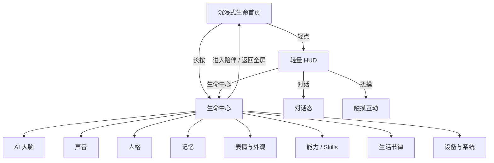
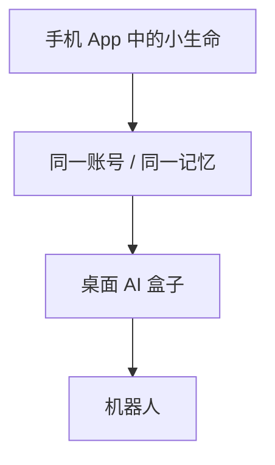

# 信息架构与交互流程

## 1. 核心信息架构



## 2. 首页轻点
```text
轻点
↓
显示轻量 HUD
↓
2～4 秒无操作自动淡出
```

HUD：
```text
对话 / 抚摸 / 生命中心
```

## 3. 首页长按
```text
长按 400～600ms
↓
轻触觉反馈
↓
进入生命中心
```

## 4. AI 大脑
```text
生命中心
↓
AI 大脑
├─ 当前模型
├─ 模型服务商
├─ 思考模式
└─ 高级 API 配置
```

普通用户看到“AI 大脑”，高级用户才进入 API。

## 5. 表情与外观
```text
生命中心
↓
表情与外观
├─ 表情库
├─ 生命感
├─ 显示效果
└─ Face Lab / 高级
```

现有 Alpha 1 表情调试页建议逐步演进为 `Face Lab`。

## 6. 人格
```text
人格
├─ 活泼度
├─ 好奇度
├─ 黏人度
├─ 安静度
└─ 自动成长
```

## 7. 记忆
```text
记忆
├─ 关于你的记忆
├─ 相处经历
├─ 偏好
├─ 最近记住的事
└─ 记忆设置
```

## 8. 能力
```text
能力
├─ 已安装
├─ 推荐
├─ 天气
├─ 提醒
├─ 日历
├─ 搜索
├─ 音乐
└─ 智能家居
```

## 9. 生活节律
```text
生活节律
├─ 作息
├─ 夜间安静
├─ 勿扰
├─ 主动互动频率
└─ 日夜表情
```

## 10. 设备与系统
```text
设备与系统
├─ 账号
├─ 网络
├─ 权限
├─ 数据
├─ 开发者设置
└─ 未来硬件
```

## 11. App → 硬件


结论：
```text
生命首页
    ↓
生命中心
    ↓
能力详情
```

不要采用：
```text
首页 / AI / 表情 / 我的
```
