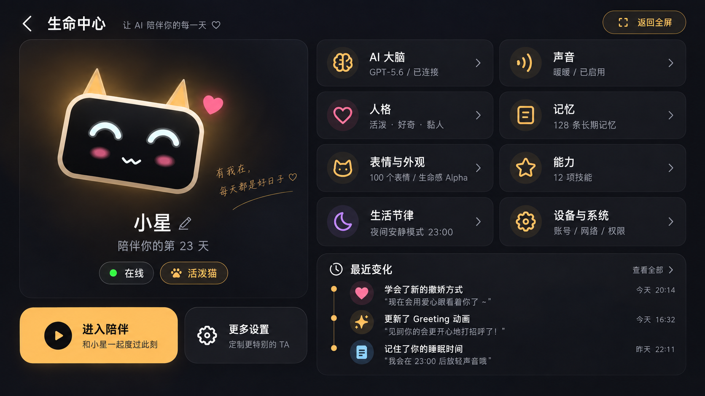

# AI 小生命「生命中心」页面设计说明

> 本文档用于交给本地 AI / 本地工程助手，基于附图完成一个 **可实现的生命中心页面**。该页面是 AI 小生命 App 的 **二级入口页**，位于“沉浸式全屏表情首页”之后。

---

## 1. 页面定位

这个页面不是传统“设置页”，而是：

**生命中心 / Companion Center**

它承担以下作用：

1. 作为沉浸式首页与各功能设置页之间的中枢页面
2. 让用户理解“这只 AI 小生命由哪些能力组成”
3. 为未来接入新的能力提供统一入口，例如：
   - 大模型 / AI 大脑
   - 声音 / TTS
   - 人格
   - 记忆
   - 表情与外观
   - 技能 / 能力
   - 生活节律
   - 设备与系统
4. 保持产品的“生命体”叙事，而不是把它做成普通工具型 App

---

## 2. 设计目标

### 2.1 核心设计原则

- 首屏仍然是**全屏沉浸式生命体**
- 生命中心是**轻控制台**，不是后台管理系统
- 信息清晰，但不打破温暖、陪伴、拟生命的感觉
- 允许未来长期扩展，不因增加新能力而推翻导航结构

### 2.2 页面属性

- **横屏优先**
- 同时支持“跟随屏幕方向自适应”
- 当前设计稿以 **16:9 横屏** 为主
- 页面风格应与首页保持统一：
  - 深色背景
  - 柔和金色光晕
  - 高级感、温暖感
  - 低打扰、低信息噪音

---

## 3. 附图

请重点参考下图：

> 本地图路径：`assets/生命中心_横屏设计稿.png`

这张图是当前建议的主方向，请尽量在布局、氛围、信息层次、模块组织上保持一致。

---

## 4. 信息架构

### Level 0：沉浸式首页

全屏显示 AI 小生命表情与动画，尽量不出现传统导航。

进入生命中心的方式建议：
- 长按屏幕
- 或轻点后弹出轻量 HUD，再进入“生命中心”

### Level 1：生命中心（本页）

生命中心是总入口页。

### Level 2：能力详情页

从生命中心进入的各个详情页，例如：
- AI 大脑详情
- 声音设置页
- 人格设置页
- 记忆管理页
- 表情与外观页
- 能力 / Skills 页
- 节律设置页
- 设备与系统页

---

## 5. 页面布局结构

页面采用 **左右双栏 + 底部信息区** 的结构。

### 左侧：角色卡片区

展示 AI 小生命本体与关键信息。

建议包含：
- 小生命形象卡片
- 名称（如：小星）
- 陪伴天数（如：陪伴你的第 23 天）
- 在线状态标签
- 人格标签（如：活泼猫）
- 进入陪伴 按钮
- 更多设置 按钮

#### 左侧卡片的作用

- 让用户明确当前操作对象是谁
- 强化“这是一只正在陪伴我的生命体”
- 让设置页始终带着角色温度，而不是冷冰冰的工具感

---

### 右侧：模块卡片区

采用 2 列卡片式模块布局。

建议模块如下：

1. **AI 大脑**
   - 当前模型提供商
   - 当前模型名
   - 连接状态

2. **声音**
   - 当前音色
   - 是否启用

3. **人格**
   - 活泼 / 好奇 / 黏人 等人格摘要

4. **记忆**
   - 长期记忆条数
   - 是否启用记忆

5. **表情与外观**
   - 当前表情系统版本
   - 表情数量 / 生命感模式

6. **能力**
   - 已开启技能数量
   - 能力入口

7. **生活节律**
   - 夜间安静模式
   - 睡眠时间等

8. **设备与系统**
   - 账号 / 网络 / 权限 / 硬件信息

---

### 底部右侧：最近变化 / 成长记录

建议增加一块“最近变化”时间线区域，用来增强成长感。

示例：
- 学会了新的撒娇方式
- 更新了 Greeting 动画
- 记住了你的睡眠时间

这个区域非常重要，它能让用户感觉：

> 它不是一套配置，而是在成长。

---

## 6. 导航建议

### 不建议

- 不建议把这个页面做成普通设置列表
- 不建议使用传统底部 TAB：`首页 / AI / 表情 / 我的`
- 不建议首页直接塞很多按钮，破坏沉浸式体验

### 建议

- 首页保持生命体沉浸式全屏
- “生命中心”作为唯一的总控制入口
- 从生命中心再进入各详情页

这样未来增加新能力时，不会缺少入口，也不会破坏首页。

---

## 7. 交互建议

### 首页 → 生命中心

推荐以下任一方案：

#### 方案 A：长按进入
- 长按沉浸式首页
- 直接进入生命中心

#### 方案 B：轻点浮出 HUD（更推荐）
- 轻点首页
- 短暂浮出轻量操作层
- 提供：对话 / 抚摸 / 生命中心
- 自动淡出

#### 方案 C：长按 + 右上角极简入口并存
- 新用户更容易发现
- 老用户仍可直接长按进入

---

## 8. 横屏与跟随屏幕方向

你的判断是对的：

> **生命中心更适合做成横屏页面，或至少支持跟随屏幕方向。**

### 原因

1. 当前角色卡片 + 多模块卡片，横屏空间利用率更高
2. 更接近未来桌面 AI 盒子或硬件屏幕的交互形态
3. 页面更有“控制台 / 中心页”的感觉
4. 左右分区能同时兼顾“角色感”和“功能扩展”

### 建议实现

#### 当前阶段
- 先做横屏主设计稿
- 保证 16:9 下视觉最优

#### 后续阶段
- 增加自适应：
  - 横屏：左右双栏
  - 竖屏：上角色卡，下模块列表

也就是说：

**默认横屏最佳，但跟随屏幕方向自适应更稳妥。**

---

## 9. 视觉风格要求

### 关键词
- 深色
- 温暖
- 高级
- 低噪音
- 陪伴感
- 生命感
- 轻科技感

### 色彩
- 背景：深蓝黑 / 黑灰
- 主强调色：暖金 / 柔和琥珀色
- 次强调色：粉色、紫色、蓝色，用于不同模块区分
- 高亮状态：金色描边 / 发光

### 组件风格
- 大圆角
- 卡片式模块
- 轻描边 + 柔和阴影
- 弱对比但层级清晰
- 尽量不使用过重分割线

---

## 10. 功能扩展策略

未来如果新增能力，统一加在生命中心，不要回到首页塞入口。

可扩展能力示例：
- 大模型服务商切换
- 联网搜索
- 日历 / 提醒
- 音乐
- 智能家居
- 摄像头能力
- 远程在场
- 硬件绑定
- 开发者模式

新增能力时的规则：

1. 优先作为“模块卡片”出现在生命中心
2. 再从卡片进入更深一层详情页
3. 不破坏首页沉浸式生命体结构

---

## 11. 适合交给本地 AI 的开发任务

请本地 AI 根据本说明与附图，完成以下工作：

### 第一阶段
1. 实现一个**可运行的生命中心页面原型**
2. 页面需尽量还原附图布局与风格
3. 支持横屏显示
4. 角色卡片与功能卡片可点击
5. 页面具备基础组件拆分能力

### 第二阶段
1. 增加跟随屏幕方向自适应
2. 竖屏下重排为单列 / 双段结构
3. 打通首页进入生命中心的交互

### 第三阶段
1. 衔接“表情与外观”页面
2. 预留 AI 大脑 / 记忆 / 技能等页面导航
3. 加入真实数据驱动的成长时间线

---

## 12. 推荐组件拆分

建议拆分为以下组件：

- `LifeCenterPage`
- `CompanionProfileCard`
- `StatusBadge`
- `ActionButtons`
- `FeatureCard`
- `FeatureGrid`
- `RecentChangesTimeline`
- `TopBar`

如果用 Compose 开发，也建议保持组件化，后续方便迁移到 App / AI 盒子 / 机器人控制端。

---

## 13. 页面文案建议

### 页面主标题
- 生命中心

### 副标题
- 让 AI 陪伴你的每一天
- 或：让智能，有生命

### 角色区示例文案
- 小星
- 陪伴你的第 23 天
- 有我在，每天都是好日子

### 行动按钮
- 进入陪伴
- 更多设置
- 返回全屏

---

## 14. 最终目标

这个页面不是一个“设置中转页”，而是未来整个 AI 小生命产品体系的：

**统一控制中心 / 统一能力入口 / 品牌叙事延伸页**

它应该满足三个要求：

1. 用户觉得它属于“这只生命体”
2. 产品团队可以不断往里加能力
3. 未来迁移到桌面 AI 盒子与机器人时，信息架构仍然成立

---

## 15. 一句话总结

> **首页负责“让用户感受到生命”，生命中心负责“让用户理解并管理这份生命”。**
